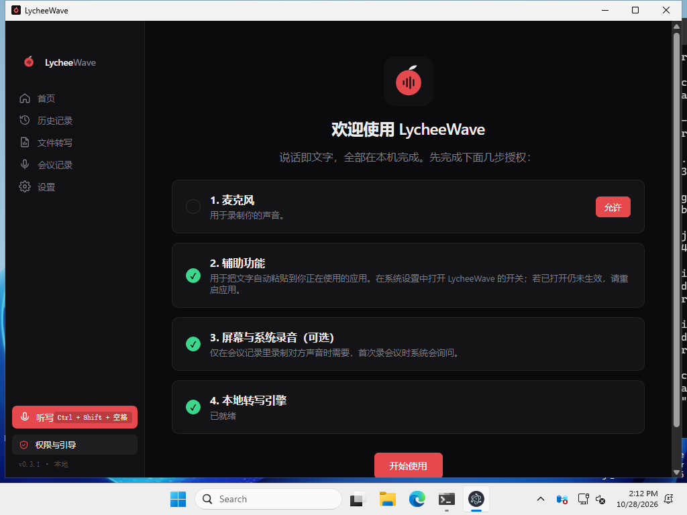
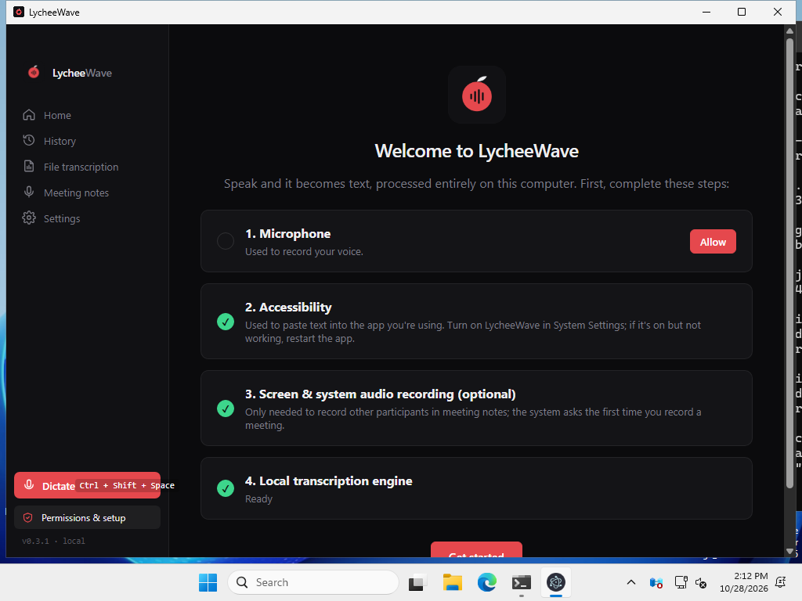
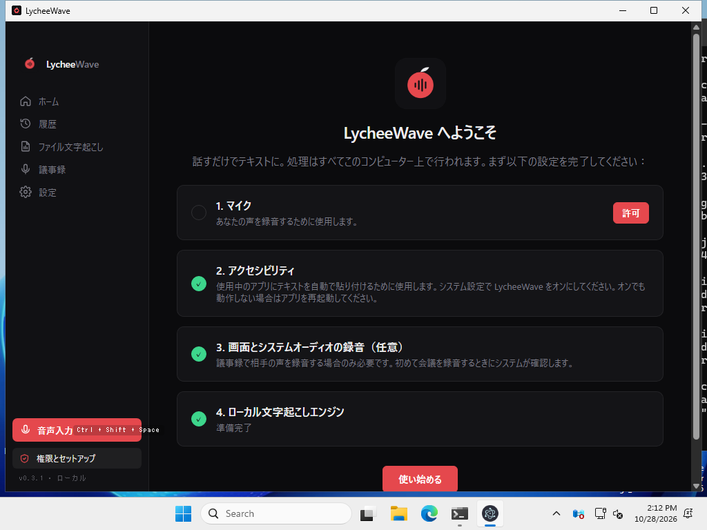

# Windows test results / Windows 真实系统测试结果

- **Build tested:** LycheeWave 0.3.1 Windows x64 (`setup.exe` + portable `zip`), cross-built on Linux
- **System:** GitHub Actions `windows-latest`: Windows Server 2025 Datacenter 24H2, build 26100.33650 (real Windows, not wine)
- **Run:** https://github.com/LHX693/lycheewave-app/actions/runs/40703246667 (2026-10-28, 23:08 JST)
- **How:** [`.github/workflows/windows-test.yml`](.github/workflows/windows-test.yml) + [`scripts/windows-test.ps1`](scripts/windows-test.ps1); logs in [`logs/windows-test/`](logs/windows-test/)

| Test | Result |
|---|---|
| SHA-256 of setup.exe and zip match SHA256SUMS.txt | PASS |
| Silent install `setup.exe /S` → `%LOCALAPPDATA%\Programs\LycheeWave`, uninstall registry entry, Start Menu shortcut | PASS |
| Packaged self-test `--lw-selftest` (installed) | PASS, 18/19 (see note) |
| Bundled `whisper-cli.exe` transcribes jfk.wav ("…ask not what your country can do for you…") | PASS |
| GUI launch in zh-CN / en / ja, screenshot not blank | PASS |
| Portable zip: launch + self-test | PASS, 18/19 |
| Silent uninstall: files, registry entry and shortcut removed (user data in %APPDATA% kept, by design) | PASS |

**Self-test note:** the only failing check is "data dir 0700 / files 0600". It tests POSIX file modes, which NTFS doesn't have (Node reports 666). That doesn't apply on Windows: the files are under the user's own %APPDATA% profile, which other standard users can't read by default. The API key is still encrypted at rest with DPAPI (`enc:v1:…`). The hostile file name `$(touch PWNED);-y \`id\`.mp3` is transcribed and no command runs.

**Not covered:** SmartScreen. The runner downloads with gh, so the files have no Mark-of-the-Web and SmartScreen never prompts. Real users will likely see "Windows protected your PC" because the build is unsigned (More info → Run anyway). Microphone recording, global hotkey and auto-paste can't be tested without hardware or an interactive user.

## Bugs found and fixed in 0.3.1
1. **Blank window on Windows (critical):** every window was empty. Chromium returned `ERR_FILE_NOT_FOUND` for `app.asar/out/index.html` while the `GrantFileProtocolExtraPrivileges` fuse was disabled. That fuse is now enabled (Electron's default). Pages stay locked down by CSP, the navigation guard, and blocked new windows and webviews.
2. **Page guard broken on Windows:** `isOwnPage` built the path from `URL.pathname` (`/C:/…`), so our own pages were never recognised. That would have denied the microphone and screen-capture permissions. It now uses `fileURLToPath` with a case-insensitive comparison on Windows, and there are new unit tests and a self-test check.
3. **Sidebar version hard-coded** as v0.3.0; it now comes from package.json at build time.

Known cosmetic issue: on Windows, onboarding step 2 (Accessibility) still has macOS wording. It's already marked done there.

## Screenshots
| zh-CN | en | ja |
|---|---|---|
|  |  |  |
